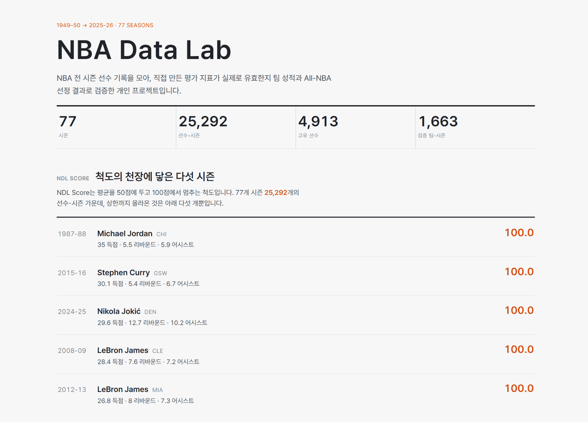

# NBA DATA LAB

NBA 77개 시즌 선수 데이터를 수집·가공하고, 직접 만든 선수 평가 지표가 실제로 유효한지
팀 성적으로 검증한 개인 프로젝트입니다.

[](https://nba-data-lab.vercel.app)

**▶ 이미지를 클릭하면 실제 사이트로 이동합니다 — https://nba-data-lab.vercel.app**

[시즌별 스탯](https://nba-data-lab.vercel.app/stats) ·
[NDL Score](https://nba-data-lab.vercel.app/ndl) ·
[선수 커리어](https://nba-data-lab.vercel.app/player) ·
[선수 포지셔닝](https://nba-data-lab.vercel.app/scatter) ·
[시즌 시뮬레이션](https://nba-data-lab.vercel.app/game) ·
[다음 시즌 예측](https://nba-data-lab.vercel.app/projection) ·
[예측 모델](https://nba-data-lab.vercel.app/model)

| | |
|---|---|
| 수집 | 77개 시즌(1949-50 ~ 2025-26), 선수-시즌 25,292행, 고유 선수 4,913명 |
| 검증 | 팀-시즌 1,663개(1947~2024) |
| 기술 | Python, pandas, NumPy, SciPy, 정적 HTML/CSS/JS |

**요약**

- 임의로 정했던 지표 가중치를 팀 실제 성적으로 학습시켜, 학습에 쓰지 않은 2016~2024 구간에서
  **9개 시즌 전부 개선**(0.878 → 0.922)되는 것을 확인했습니다.
- 두 가지 방식으로 채점했습니다. 팀 성적 설명력은 공인 지표에 못 미치지만(0.890 vs WS 0.941),
  **그해 최고 선수를 뽑는 정확도는 더 높았습니다**(All-NBA 일치율 65.8% vs WS 64.5%).
- **측정해보고 채택하지 않은 시도가 두 개** 있습니다. 판단 근거를 수치로 적었습니다.
- 같은 데이터로 **다음 시즌 점수도 예측**합니다(오차 4.61 → 4.07). 여기서 세 번 틀렸는데,
  세 번 다 **전체 평균이 가려놓은 것**이었습니다. 무엇을 놓쳤는지 7절에 적었습니다.
- 선수 예측을 로스터 단위로 모아 **다음 시즌 팀 성적까지 예측**했습니다. 승수 오차가
  8.4승 → 6.7승으로 줄었고 **시험한 11개 시즌 전부** 기준선보다 나았습니다. 다만 **수비는
  작년 팀 성적보다도 못 맞혔습니다**. 이 결과로 2026-27 순위를 예측해 8절에 적었습니다.

---

## 문제 정의

선수 한 명의 기여도를 하나의 숫자로 나타내는 공인 지표가 이미 여럿 있습니다(PER, WS, BPM).
다만 계산 과정이 **블랙박스에 가까워, 점수가 왜 그렇게 나왔는지 항목별로 알 수 없습니다.**
그래서 득점·효율·플레이메이킹·수비·승리기여 5개 축으로 이루어진 지표를 직접 만들었습니다
(NDL Score).

문제는 그다음입니다. 5개 축을 하나로 합치려면 가중치가 필요한데, 처음에는 임의의 값으로
시작할 수밖에 없었습니다(25/20/15/20/20). 이 배분이 맞는지 확인할 방법이 없다면 지표가
그럴듯해 보여도 근거는 없는 셈입니다. **이 프로젝트의 대부분은 그 초기값을 검증 가능한
값으로 바꿔 나간 과정입니다.**

## 접근

### 1. 데이터 파이프라인

시즌별로 파일을 따로 저장하고 이미 받은 시즌은 건너뛰도록 해 중간에 끊겨도 이어받을 수
있게 했습니다. 받아온 원본은 로컬에 보관해, 지표 공식을 바꿔도 다시 받지 않고 전체를
재계산합니다.

까다로웠던 건 **기록 항목이 시대마다 다르다**는 점입니다. 스틸·블록은 1973-74, 턴오버는
1977-78, 3점슛은 1979-80, 슛 위치는 1996-97 시즌부터 집계됩니다. 그 이전에는 해당 칸이
아예 없습니다.

여기서 버그가 발생했습니다. "이 시대에 없는 기록"은 처리해뒀는데 **"있지만 이 선수만 빠진"**
경우를 놓쳐, 빈 값이 덧셈으로 번지면서 **1,409명(1970-71~1974-75 시즌 선수의 90%)의 점수가
사라졌습니다.** 두 경우를 구분해 후자는 그 항목만 빼고 계산하도록 고쳤습니다.

### 2. 채점 기준 만들기

가중치를 검증하려면 정답지가 필요합니다. **팀의 경기당 평균 득실차**를 정답지로 삼았습니다.

이 값을 서로 다른 두 공개 데이터셋에서 각각 계산했습니다. 겹치는 **146개 팀-시즌에서 두 값이
소수점 이하까지 일치**하는 것을 확인한 뒤 사용했습니다.

채점 방식은 이렇습니다. 한 팀 선수들의 점수를 출전시간 가중 평균해 팀 점수를 만들고, 그 값이
**그 팀의 실제 득실차를 얼마나 설명하는지** 상관계수로 잽니다. 시즌마다 구해 평균 냅니다.

### 3. 가중치 학습 — 뻔한 답으로 쏠리는 문제

제약 없이 최적화하자 **5개 축 중 승리기여 하나가 전체 가중치의 83%를 가져갔습니다.**

당연한 결과였습니다. 승리기여 축은 WS·VORP를 재료로 쓰는데, **이 두 지표 자체가 팀 성적에서
거꾸로 계산해 선수에게 나눠준 값**입니다. 팀 성적을 맞히라고 시켰더니 팀 성적으로 만든 재료를
고른 셈입니다. 이 답을 쓰면 NDL Score는 기존 지표의 재포장이 되고, 5개 축으로 분해한다는
목적이 사라집니다. 그래서 **각 축을 5~40%로 제한**했습니다.

과거 데이터에만 맞는 답을 거르기 위해 데이터를 세 덩어리로 나눴습니다.

- **학습용** — 1952~2015년 홀수 연도 시즌. 가중치는 여기서만 학습
- **검증용** — 같은 기간 짝수 연도 시즌
- **최종 시험용** — 학습·검증 어디에도 쓰지 않은 **2016~2024**. 3점슛 비중이 크게 늘어 경기
  양상이 달라진 구간이라, 여기서도 개선이 유지되는지가 판단 기준입니다

### 4. 두 번째 채점 — All-NBA 일치율

팀 득실차 검증은 "좋은 선수가 많은 팀이 실제로 잘했나"를 보는 간접 방식입니다. 더 직접적인
기준으로, **그 시즌 최고 선수 명단을 얼마나 맞히는지**도 쟀습니다. 지표 상위 N명과 실제
All-NBA 선정 N명(1·2·3팀)의 겹치는 비율입니다.

### 5. 검토했지만 채택하지 않은 것 (1) — 팀 환경 보정

수비 기록은 팀 환경을 탑니다. 수비 좋은 팀에 있으면 개인 기록도 좋아 보일 수 있어,
**팀 덕분에 얻은 몫을 걷어내고 개인 기여분만 남기는 보정**을 만들었습니다. 같은 팀 동료들의
수비 지표(본인 제외)로 회귀분석을 돌려, 설명되지 않는 부분만 개인 몫으로 보는 방식입니다.

재보니 **개선폭이 +0.002에 그쳐 넣지 않았습니다.** 같은 회귀 아이디어를 개인 보정이 아니라
가중치 학습에 쓴 쪽이 +0.044로 훨씬 효과적이었습니다.

부산물이 하나 있습니다. 회귀계수가 **음수**로 나왔는데, 동료가 수비를 잘할수록 개인의
리바운드·스틸 기록이 오히려 줄어든다는 뜻입니다. 리바운드 하나는 한 명만 잡으니 잘하는
동료와 기록을 나눠 갖게 됩니다.

### 6. 검토했지만 채택하지 않은 것 (2) — 비율 대신 개수

플레이메이킹·수비기여 축은 비율(AST%, STL% 등)을 쓰는데, 생산성 축은 같은 종류의 기록을
경기당 개수로 씁니다. 한 지표 안에 두 방식이 섞여 있어, **네 가지 조합을 전부 학습·검증**했습니다.

축 하나만 놓고 보면 **개수 쪽이 우세**했습니다(플레이메이킹 0.410→0.479, 수비기여 0.339→0.418).
그런데 **최종 지표는 오히려 나빠졌습니다**(0.935→0.930).

원인은 **정보 중복**입니다. 수비기여를 개수로 바꾸면 생산성 축과 상관이 **0.902**까지 올라갑니다.
생산성 축이 이미 리바운드·스틸·블록을 개수로 담고 있어 같은 것을 두 번 재는 셈입니다
(비율은 0.329로 서로 다른 것을 잽니다). 네 조합의 순위도 중복 정도와 같은 순서였습니다.

| 플레이메이킹 | 수비기여 | 최종 시험 점수 |
|---|---|---|
| 개수 | 비율 | 0.9372 |
| 비율 | 비율 | 0.9351 *(현재)* |
| 개수 | 개수 | 0.9295 |
| 비율 | 개수 | 0.9270 |

1위 조합이 현재보다 +0.0021 나았지만, 앞서 +0.002를 이유로 버린 것과 같은 크기라
**기준을 일관되게 적용해 채택하지 않았습니다.**

> 이 실험에서 얻은 건 성능이 아니라 이 사실입니다 —
> **혼자 놓고 보면 더 좋은 재료가, 합쳐 놓으면 더 나쁜 결과를 낼 수 있다.**

### 7. 다음 시즌 예측 — 나이 곡선과 기량 구간

지표를 만들었으니 **다음 시즌을 맞힐 수 있는지**도 물어봤습니다. 선수-시즌이 25,292개라
나이별 추세를 뽑을 표본은 충분했습니다. 연속 두 시즌을 모두 뛴 쌍이 14,217개 나왔고,
나이별 평균 변화를 이으면 **25~26세에 정점을 찍고 이후 완만히 내려가는** 곡선이 나옵니다.

기준선부터 쌓아 올리며 매번 홀드아웃(2016-17년 이후)에서 측정했습니다.

| 모델 | MAE | 상관 |
|---|---|---|
| 작년 성적 그대로 | 4.61 | 0.730 |
| 최근 3시즌 가중평균(5:4:3) | 4.40 | 0.742 |
| + 평균회귀 | 4.23 | 0.740 |
| + 나이 보정 | 4.16 | 0.759 |
| + 기량 구간별 회귀 | 4.13 | 0.761 |
| + 시즌별 비중 학습 | 4.08 | 0.764 |
| **+ 유망주 성장 보정** | **4.07** | **0.766** |

**여기서 세 번 틀렸고, 세 번 다 "전체 평균"이 숨긴 것이었습니다.**

**하나.** 나이 보정을 넣어도 전체 MAE가 0.03밖에 줄지 않아 효과가 없어 보였습니다. 나이대별로
쪼개보니 **33세 이상에서만 3.99→3.38로 15% 개선**되고, 젊은 층에서는 오히려 나빠지고 있었습니다.
두 효과가 서로를 지워 평균에서는 0으로 보인 것입니다. 원인은 **생존 편향**입니다 — 나이 곡선은
다음 시즌에도 리그에 남은 선수로만 계산되는데, 20세에 리그를 떠난 선수의 평균은 47.7,
남은 선수는 50.0이었습니다. 못한 선수가 표본에서 통째로 빠져 젊은 나이대의 상승폭이 부풀려집니다.

**둘.** 평균회귀 강도를 `출전시간/(출전시간+2000)`이라는 식으로 **제가 정했습니다**. 점수대별
편향을 재보니 이것이 상위권을 과도하게 끌어내리고 있었습니다.

| 올해 점수대 | 실제 내년 평균 | 모델 예측 | 편향 |
|---|---|---|---|
| 40~49 | 48.8 | 49.0 | +0.2 |
| 60~69 | 61.1 | 59.3 | −1.8 |
| 80~89 | 80.7 | 75.0 | **−5.7** |
| 90~99 | 88.0 | 81.5 | **−6.5** |

손으로 정한 상수를 빼고 **계수를 최소제곱으로 추정**하자 모든 구간의 편향이 ±0.6 안으로
들어왔습니다. 추정된 회귀 강도는 12%로, 제가 넣었던 21%의 절반이었습니다.

**셋.** 그래도 요키치 같은 선수가 한 해 만에 크게 떨어진다는 예측은 어색했습니다. 등급을
나눠 재보니 **평균회귀의 크기가 등급마다 전혀 달랐습니다.**

| 직전 3시즌 평균 | 표본 | 다음 시즌 평균회귀율 |
|---|---|---|
| 80점 이상 | 157 | **6.1%** |
| 70~80 | 484 | 11.6% |
| 60~70 | 1,910 | 13.4% |
| 50~60 | 6,599 | 9.3% |
| 50 미만 | 5,067 | **53.6%** |

기울기를 하나만 두면 전원에게 12%가 적용되어 **상위권을 두 배로 끌어내립니다.** 그래서
기량 구간별로 기울기를 따로 추정했습니다. 다만 자유롭게 두면 70~80 구간이 1.058, 즉
"평균에서 멀어진다"는 값을 내놓습니다. 상위 구간 표본이 얇아서 생기는 과적합입니다.
그래서 **기울기가 구간에 따라 줄지 않고 1을 넘지도 않는다**는 두 제약을 걸고, 그 안에서
데이터가 값을 고르게 했습니다. 가설을 모델이 아니라 제약으로 넣은 것입니다.

나이 델타도 같은 방식으로 젊은 구간과 30세 이상 구간의 계수를 따로 추정했고,
**0.87 대 1.42**가 나왔습니다 — 생존 편향 이야기와 일치하게, 젊은 구간 곡선을 덜 신뢰합니다.
결과적으로 요키치의 예측이 **91.3 → 94.2**로, 하락폭이 −6.8에서 −3.9로 줄었습니다.

> 세 번 다 같은 실수였습니다 —
> **전체 평균 하나만 보고 판단했고, 상수를 데이터에 묻지 않고 직접 정했다.**

손으로 정한 상수가 하나 더 남아 있었습니다. **최근 3시즌 가중치 5:4:3**입니다. `직전 시즌 −
가중평균` 항을 하나 더해 시즌별 비중을 데이터가 고르게 했더니, 계수가 0.29로 나오며 직전
시즌 비중이 42%에서 **60%**로 올라갔습니다(60점대 선수 기준 60:23:17). 전체 오차 4.13 → 4.08,
부트스트랩 신뢰구간 `[+0.015, +0.082]`로 0을 포함하지 않습니다. 이번에는 나이대(23세 이하·24~29·
30세 이상)와 예측 점수대(50 미만·50~70·70 이상)로 쪼개 **모든 구간에서 줄었는지**부터
확인했습니다. 가장 크게 준 곳은 70점 이상(7.76 → 7.54)이었습니다. 같은 방식으로 출전시간·경기수·
선발 비율·경력 연차도 넣어봤지만 0.01 안팎이라 넣지 않았습니다.

**"스타와 유망주를 너무 깎는다"는 지적도 데이터에 물었습니다.** 맥시(75.4 → 68.0)나 머리(73.3 →
65.7)의 하락이 어색하다는 피드백이었는데, 쪼개보니 나이 보정은 0.0·−1.3에 그쳤고 하락은 대부분
**한 해 급등**에서 왔습니다(맥시 65.2 → 58.8 → 75.4). 77개 시즌 전체에서 그룹별로 실제와 예측을
비교했습니다.

| 그룹 | 표본 | 올해 → 실제 다음 해 | 모델 편향 |
|---|---|---|---|
| 24~29세, 한 해 +7점 이상 급등, 68점 이상 | 102 | 76.9 → 70.8 | 1.9점 더 깎음 |
| 　└ 그중 최근 10년(시험 구간) | 25 | | **1.2점 덜 깎음** |
| 26~29세 스타(65점 이상), 최근 10년 | 76 | | **2.6점 덜 깎음** |
| 한 시즌 뛴 신인 60점 이상, 최근 10년 | 14 | | 3.3점 높게 예측 |
| **22세 이하, 기량 60점 이상** | 179 | 68.5 → 69.1 | **1.5점 덜 키움** |

급등한 선수는 실제로도 다음 해 6점 넘게 내려왔고, 최근 10년에는 모델보다 더 내려왔습니다.
급등한 해를 기량별로 더 믿게 하는 항은 계수가 0으로 나와 넣지 않았습니다. 첫해에 잘한 신인도
2년차에 오히려 내려오는 쪽이었습니다. **맞는 지적은 유망주 하나였습니다.** 나이 곡선은 결국
자리 잡지 못하는 선수까지 섞인 평균이라, 잘하는 어린 선수의 성장을 덜 줍니다. 그래서 젊은 구간
나이 델타에 기량(55점 위로 10점마다 1)을 곱한 항을 더했습니다(2시즌 이상 뛴 선수만). 오차
4.083 → 4.065(신뢰구간 `[+0.010, +0.028]`), 22세 이하·60점 이상의 편향은 +1.62 → +0.65로
줄었습니다. 웸반야마 73.3 → 75.4, 듀런 69.2 → 70.9로 올랐습니다. 같은 항이 26~29세 스타는 조금
더 내리는데(길저스알렉산더 91.8 → 90.7), 위 표의 최근 10년 기록과 같은 방향입니다.

**그래도 예측은 보수적입니다.** 기대 경로만 이어 붙이면 플래그는 63, 크니펠은 69에서 멈춥니다.
그런데 21세 이하에 신인 시즌 60~70점을 낸 선수 28명 중 **32%가 5년 안에 80점을 넘었습니다**
(르브론·커리·요키치·돈치치·앤서니 데이비스…). 요키치(25세 예측 78 → 실제 97)처럼 모델은 도약을
한 해 늦게 따라갑니다. 숫자 하나는 비슷한 선수들의 가운데값이라 이 꼬리를 담을 수 없습니다. 그래서
가운데값은 그대로 두고 두 가지를 덧붙였습니다.

- **다음 시즌 80% 범위** — 나이·기량·경력이 비슷한 그룹에서 실제가 예측을 벗어난 폭(1990년 이후).
  2015년까지로 만든 범위에 이후 시즌의 **80.3%**가 들어왔습니다. 기량 70점 이상은 73%로 좁은데,
  대부분 범위보다 더 떨어진 경우입니다
- **5년 안에 70·80·90점 도달 확률** — 같은 나이에 점수·3시즌 평균·경력이 가장 비슷한 과거 선수
  30명이 이후 실제로 **오른 폭**을 옮겨 붙였습니다. 처음에는 비교 선수의 최고점을 그대로 썼는데,
  최상위 선수는 위쪽에 비교 대상이 없어 확률이 체계적으로 낮았습니다(30~50% 예측 → 실제 57%)

확률은 2010-11~2020-21 시즌 3,835개 선수-시즌을 그 시점에 결과가 나와 있던 선수만으로 예측해
맞춰봤습니다.

| 80점 도달 예측 | 5~15% | 15~30% | 30~50% | 50~80% | 80~100% |
|---|---|---|---|---|---|
| 실제 도달 | 9% | 20% | 34% | 53% | 93% |

이제 크니펠은 "내년 66.3(55~76), 5년 안에 80점 27%", 듀런은 "70.9(60~81), 43%"로 보입니다.
한계도 둘 있습니다. **90점 도달은 실제의 절반 수준으로 낮게** 나옵니다(평균 예측 0.8% / 실제 1.2%).
90점대 시즌이 2010년대 이후 두 배로 늘어 과거 비교 풀이 따라가지 못합니다. 또 **부상 시즌을
구분하지 못해**, 올해 부상으로 62점에 그친 아데토쿤보(32세)의 80점 도달 확률이 0%로 나옵니다.

**고쳤다고 단정하지는 않았습니다.** 80점 이상 선수-시즌은 역대 157개, 검증 구간에는
32개뿐입니다. 부트스트랩으로 그 구간의 편향 신뢰구간을 구하면 고치기 전 `[−4.12, +2.81]`,
고친 뒤 `[−2.34, +4.84]`로 **둘 다 0을 포함**합니다. 상위권 예측이 나아졌다고 말할 통계적
근거는 없습니다. 단정할 수 있는 것은 전체 오차 **4.16 → 4.13**까지이고(신뢰구간
`[+0.006, +0.036]`), 상위권 개선은 관측된 회귀율과 제약이 근거일 뿐 검증된 사실이 아닙니다.

한계는 분명합니다. 부상·이적·역할 변화·신인은 반영하지 못하고, 직전 세 시즌 기록과 나이만
씁니다. 평균 4.1점 오차는 순위를 뒤집기 충분한 크기라, 개별 선수의 예측값보다 추세로 읽는
편이 맞습니다. 결과는 [다음 시즌 예측](https://nba-data-lab.vercel.app/projection) 페이지에
공개해 두었습니다 — 맞고 틀림은 시즌이 끝나면 드러납니다.

### 8. 팀 성적 예측 — 선수 예측을 모으면 팀이 맞을까

7절의 선수 예측 위에 한 단계를 더 쌓았습니다. 예를 들어 2017-18 클리블랜드라면, 그 시즌
로스터 선수 전원의 NDL을 **2016-17까지의 기록만으로** 예측합니다. 이것을 출전 비중으로
가중평균해 그 시즌 팀의 공격 레이팅(ORtg)과 수비 레이팅(DRtg)을 맞힙니다. 리그 전체 득점
수준은 시대마다 10점 넘게 움직이기 때문에, 목표값은 리그 평균을 뺀 값으로 잡았습니다.

가장 신경 쓴 건 **시즌 시작 시점에 알 수 없는 정보를 쓰지 않는 것**입니다. 그 시즌 실제
출전시간을 쓰면 부상·트레이드·기용 변화를 미리 아는 셈이 됩니다. 그래서 두 가지를 정했습니다.

- **로스터** — 그 시즌에 처음 뛴 팀을 소속으로 봅니다. 개막 로스터로 예측하는 셈입니다
- **출전 비중** — 직전 시즌 경기당 출전시간을 씁니다. 기록이 없는 신인은 학습 구간에서 같은
  처지였던 선수들의 평균(NDL 49.8, 13.7분)을 줍니다

실제 출전시간을 쓴 버전은 상한선을 보려고 따로만 쟀습니다. 학습은 1979~2015 시즌, 시험은
2016~2026 시즌(330팀-시즌)입니다. 피처 조합은 학습 구간 안에서 시즌을 하나씩 빼 맞혀보는
교차검증으로만 골랐습니다.

| 모델 | 순레이팅 오차 | 승수 오차 | 순레이팅 상관 | 컨퍼런스 상위 6팀 적중 |
|---|---|---|---|---|
| 모두 리그 평균 | 3.86 | 9.8승 | — | 7.4 / 12 |
| 작년 팀 성적 그대로 | 3.37 | 8.4승 | 0.586 | 7.8 / 12 |
| **로스터 NDL 예측** | **2.73** | **6.7승** | **0.686** | **8.2 / 12** |
| *(참고) 실제 출전시간을 안다면* | *2.56* | *6.2승* | *0.752* | *9.0 / 12* |
| *(참고) 선수 성적까지 안다면* | *1.15* | *3.1승* | *0.956* | — |

시즌별로 나눠 봐도 **11개 시즌 전부** 작년 그대로보다 나았습니다. 실제 출전시간을 알 때와의
차이는 0.17점에 그칩니다. 반면 그 시즌 **실제 선수 NDL**까지 넣으면 오차가 1.15로 절반 아래가
됩니다. 남은 오차의 대부분은 로스터·출전시간이 아니라 **선수 개개인의 다음 시즌 변화를 못
맞히는 데서** 나옵니다. 7절에서 선수 오차를 4.13 → 4.07로 줄였을 때 팀 오차는 2.74 → 2.73에
그쳤는데(상위 6팀 적중은 132자리 중 5개 덜 맞혀 8.6 → 8.2), 선수 오차의 작은 개선은 팀 단위에서
대부분 상쇄되기 때문입니다.

**공격과 수비가 전혀 다르게 나왔습니다.**

| | 공격(ORtg) 상관 | 수비(DRtg) 상관 |
|---|---|---|
| 작년 팀 성적 그대로 | 0.537 | **0.516** |
| 로스터 NDL 예측 (구성요소 포함) | **0.682** | 0.423 |
| + 작년 팀 레이팅 | 0.668 | 0.545 |
| *(참고) 그 시즌 실제 선수 기록* | *0.901* | *0.790* |

선수 기록으로 공격은 잘 맞히지만, **수비는 작년 팀 성적을 그대로 쓰느니만 못했습니다.** 그래서
작년 팀 레이팅을 피처로 함께 넣은 모델을 채택했습니다.

처음에는 수비기여 축이 같은 포지션끼리 비교한 비율 기록이라 팀 수비를 담지 못한다고
해석했습니다. **그 해석은 틀렸습니다.** 그 시즌 실제 선수 기록으로 같은 회귀를 돌리면 수비
상관이 0.790까지 오릅니다. 승리기여 축(WS·BPM이 섞여 팀 성적이 새어들 수 있는 축)을 빼도
0.788, 수비기여 축까지 빼도 0.780입니다. 선수 기록이 팀 수비를 못 담는 게 아니라, **수비 쪽
기록이 다음 시즌까지 이어지지 않아 예측이 안 되는 것**에 가깝습니다. 다만 같은 시즌 기록은
그 팀 환경에서 쌓인 값이라, 이것만으로 선수 수비가 팀 수비를 만든다고 단정할 수는 없습니다.

로스터가 많이 바뀐 팀일수록 작년 팀 레이팅을 덜 믿도록 **로스터 연속성**(작년에도 같은 팀에서
뛴 선수의 출전 비중)을 곱한 항도 넣어봤지만 수비 상관이 0.545 → 0.548로 차이가 없었습니다.

크게 틀린 팀은 세 부류였습니다. **부상**(2019-20 골든스테이트 +11.3점, 2024-25 뉴올리언스),
**탱킹**(2020-21 휴스턴·오클라호마시티), **신인·유망주의 급성장**(2025-26 샬럿·샌안토니오)입니다.
셋 다 직전 시즌 기록에는 없는 정보입니다.

이 모델로 **2026-27 시즌을 예측**했습니다. 로스터는 2026년 10월 25일 기준이고, 시즌아웃이
확정된 6명은 뺐습니다. 과거 로스터는 "그 시즌에 실제로 뛴 선수"라 시즌을 통째로 쉰 선수가
없으니, 같은 조건을 맞추기 위해서입니다. 단기 부상자는 그대로 뒀습니다.

| 순위 | 동부 | 예상 승 | 서부 | 예상 승 |
|---|---|---|---|---|
| 1 | 클리블랜드 | 50.6 | **오클라호마시티** | **63.7** |
| 2 | 보스턴 | 50.4 | 샌안토니오 | 54.2 |
| 3 | 디트로이트 | 50.4 | 휴스턴 | 52.9 |
| 4 | 뉴욕 | 48.8 | 덴버 | 52.7 |
| 5 | 토론토 | 48.1 | 미네소타 | 48.5 |
| 6 | 필라델피아 | 45.6 | LA 레이커스 | 45.5 |

평균 오차가 6.7승이라 4~5승 차이는 얼마든지 뒤집힙니다. 순위 하나하나보다 상위·중위·하위권으로
읽는 편이 맞습니다. 30개 팀 전체 순위와 팀별 선수 기여, 시즌별 백테스트는
[예측 모델](https://nba-data-lab.vercel.app/model) 페이지에 있습니다.

**신인을 전원 같은 값으로 처리한 것은 문제가 아니었습니다.** 처음에는 상위 지명 신인이 있는 팀이
낮게 잡혔을 거라 보고, 1976~2026 드래프트 기록을 받아 지명 순번별로 신인 대체값을 나눴습니다.
학습 구간에서 신인 첫 시즌 NDL은 이랬습니다.

| 지명 | 표본 | 신인 시즌 NDL | 경기당 출전 |
|---|---|---|---|
| 1~3순위 | 109 | **55.6** | 29.4분 |
| 4~10순위 | 259 | 50.2 | 23.7분 |
| 11~30순위 | 713 | 48.5~49.5 | 13~16분 |
| 31순위 이하·미지명 | 1,426 | 48.5~48.7 | 10~11분 |

1~3순위 말고는 전체 평균(49.8)과 거의 같습니다. 반영해도 팀 오차는 2.74 → 2.73으로 그대로였고,
샬럿 2025-26의 오차도 −10.5 → −10.6으로 줄지 않았습니다. 그 시즌 4순위 크니펠이 NDL 65.0을
냈는데, 같은 4~10순위 평균은 50.2이고 한 해 전 4순위 캐슬은 43.2였습니다. **지명 순번으로는
알 수 없는 이상치**였습니다. 500분 미만 기록이 있는 선수를 신인과 따로 다뤄도 마찬가지여서 둘 다
넣지 않았습니다(`exp_team_features.py`).

> 선수 예측을 모으면 팀 공격은 꽤 맞는다. 수비는 선수 기록에 담겨 있지만 **다음 시즌까지
> 이어지지 않는다.** 팀 예측을 더 낫게 하는 길은 팀 집계가 아니라 선수 예측에 있다.

### AI 활용 범위

개발 도구로 Claude Code를 사용했습니다. **코드 작성은 AI가, 무엇을 만들고 무엇을 버릴지
판단하는 것은 제가** 했습니다.

- 최적화가 **팀 성적에서 역산된 지표로 팀 성적을 맞히는 구조**임을 알아채고 제한을 건 것 (3)
- 학습·검증·최종시험으로 데이터를 나눠 검증 체계를 짠 것 (3)
- 채점 데이터를 두 출처에서 각각 구해 대조한 뒤 사용한 것 (2)
- 두 기능을 만들어 측정하고 **효과가 작아 넣지 않기로 결정한 것** (5·6)
- 선수 예측을 **과거 시즌 로스터 단위로 모아** 팀 레이팅으로 검증하는 방식을 설계한 것 (8)

## 결과

### ① 가중치 학습 전후 — 팀 성적 설명력

팀 점수가 실제 팀 득실차를 얼마나 설명하는지(상관계수). 1에 가까울수록 좋습니다.

| 구간 | 시즌 | 감으로 정한 가중치 | 학습한 가중치 | 개선 |
|---|---|---|---|---|
| 학습용 (1952~2015 홀수) | 32 | 0.828 | 0.878 | +0.050 (29/32) |
| 검증용 (1952~2015 짝수) | 32 | 0.847 | 0.894 | +0.047 (31/32) |
| **최종 시험용 (2016~2024)** | 9 | 0.878 | **0.922** | **+0.044 (9/9)** |
| 전체 | 73 | 0.842 | 0.890 | +0.048 (69/73) |

세 구간의 개선폭이 +0.044~+0.050으로 거의 같습니다. 과거 데이터에만 맞는 답을 찾은 것이라면
3점 혁명 이후 경기 양상이 달라진 최근 구간에서 개선폭이 줄어야 하는데, 그렇지 않았습니다.

### ② All-NBA 일치율 — 최고 선수를 뽑는 정확도

각 지표의 상위 N명이 실제 All-NBA 선정 N명과 얼마나 겹치는지(77개 시즌).

| 지표 | 전체 평균 | 2000년 이후 |
|---|---|---|
| **NDL Score** | **65.8%** | **69.4%** |
| WS | 64.5% | 67.7% |
| PER | 57.1% | 57.3% |
| BPM | 38.6% | 55.3% |

**팀 성적 설명력에서는 공인 지표에 뒤졌지만, 최고 선수를 뽑는 정확도에서는 앞섰습니다.**
두 채점이 서로 다른 것을 재고 있다는 뜻입니다.

이유를 확인해보니 설계 차이였습니다. NDL Score는 출전시간이 적은 선수의 점수를 평균 쪽으로
당기는데, 이 보정이 **팀 성적 상관은 약 0.02 떨어뜨리지만**(보정 없으면 0.909) 상위권 명단은
지켜줍니다. 보정이 없는 BPM은 2023-24 상위 15명에 **1~3경기만 뛴 선수가 6명** 들어갑니다.
NDL Score 상위 15명에는 40경기 미만이 한 명도 없습니다.

### 학습된 가중치

| 구성요소 | 무엇으로 계산하나 | 감으로 정한 값 | 학습한 값 |
|---|---|---|---|
| 생산성 | 득점 + 리바운드 + 어시스트 + 스틸 + 블록 − 턴오버 | 25.0% | 9.0% |
| 효율성 | 슈팅 효율 (TS%, eFG%) | 20.0% | **29.7%** |
| 플레이메이킹 | 어시스트 비율 − 턴오버 비율 | 15.0% | 9.3% |
| 수비기여 | 스틸·블록·수비리바운드 비율 | 20.0% | 12.0% |
| 승리기여 | 팀 승리 기여도 추정치 (WS, VORP) | 20.0% | **40.0%** |

생산성이 25% → 9%로 내려가고 효율성이 20% → 29.7%로 올라갔습니다. **많이 넣는 것보다
적게 던져 많이 넣는 쪽이 팀 성적과 더 붙어 있다**는 결과입니다.

> **설계 규칙 두 가지**
>
> **비교 대상을 나눕니다.** 생산성·승리기여는 리그 전체와 비교하지만, 효율성·플레이메이킹·수비기여는
> 같은 포지션끼리만 비교합니다. 센터는 골밑에서 쏘니 슈팅 효율이, 가드는 공을 오래 잡으니
> 어시스트가 구조적으로 높습니다. 보정하지 않으면 포지션이 곧 점수가 됩니다.
>
> **적게 뛴 선수는 잘라내지 않고 끌어당깁니다.** 총 출전시간이 2,000분에 못 미치는 만큼
> 점수를 평균(50점) 쪽으로 당깁니다. 표본이 작은 선수를 명단에서 지우지 않으면서도
> 상위권을 차지하지 못하게 하는 방식입니다.

## 한계

- **팀 성적 설명력은 공인 지표에 못 미칩니다.** 73개 시즌 평균으로 NDL Score 0.890,
  WS 0.941, BPM 0.987입니다. 다만 WS·BPM은 팀 성적에서 역산해 만든 지표라 이 채점에서
  유리하며, 같은 지표들이 All-NBA 일치율에서는 뒤집힙니다.
- **옛날 시즌은 평가 축이 비어 있습니다.** 1973-74 이전에는 스틸·블록을 기록하지 않아
  수비기여 축이 사실상 작동하지 않습니다.
- **시뮬레이션은 1996-97 이후만 지원합니다.** 엔진이 슛 위치를 기준으로 경기를 돌리는데
  그 이전에는 해당 데이터가 없습니다. 넣으면 모든 선수가 같은 슛 성향을 갖게 되어 제외했습니다.
- **팀 성적 채점 구간이 2024년까지입니다.** 사용한 공개 데이터셋이 그 이후를 다루지 않습니다.

### 다음에 할 것
- 2025~2026 시즌 팀 성적 데이터를 확보해 채점 구간 연장
- 시대별로 나눠 가중치 학습 (3점 도입 전후로 최적 가중치가 다를 가능성)

---

## 실행

```bash
pip install -r requirements.txt

python data/fetch_all_seasons.py --force   # 77개 시즌 수집·계산 (캐시 사용)
python data/fetch_team_margins.py          # 채점용 팀 득실차
python data/optimize_weights2.py           # 가중치 학습 (제약 조건 3종 비교)
python data/report_final.py                # 학습 전후 성능 (팀 득실차 기준)
python data/validate_allnba.py             # All-NBA 일치율
python data/exp_hybrid.py                  # 비율 vs 개수 실험
python data/build_projection.py            # 다음 시즌 선수 NDL 예측
python data/fetch_team_data.py             # 팀 ORtg/DRtg(1978~) + 2026-27 로스터
python data/build_team_projection.py       # 팀 레이팅 백테스트 + 2026-27 순위 예측
python data/exp_team_features.py           # 드래프트 순번·로스터 연속성 실험 (채택 안 함)
python data/build_site.py                  # 정적 사이트 빌드 → site/
python data/serve_site.py                  # 로컬 미리보기 → localhost:8000
```

## 구조

```
data/    파이프라인·검증 스크립트, 페이지 템플릿
site/    배포본 (Vercel이 이 폴더를 루트로 서빙, push 시 자동 배포)
```

각 페이지는 데이터를 HTML에 포함해 원본은 2~7MB이지만, 전송 시 brotli 압축으로 1MB 내외입니다.
캐시·중간 데이터는 용량 문제로 저장소에서 제외했습니다(가공 결과는 `site/` HTML에 이미 포함).
